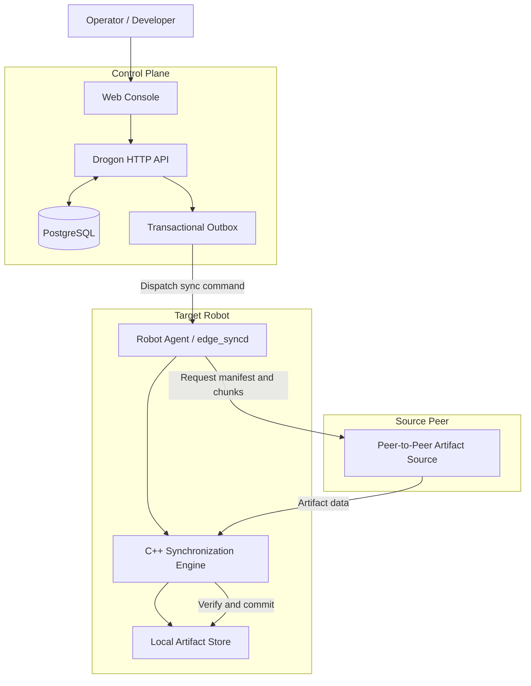
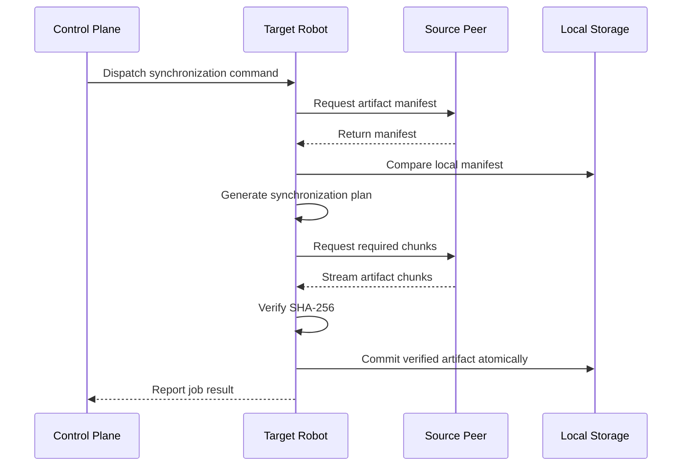

# ROS2-Edge-Sync

[](https://github.com/Louis1125/ROS2-Edge-Sync/actions)

**Reliable artifact synchronization and fleet coordination for distributed ROS 2 robots.**

ROS2-Edge-Sync is an open-source synchronization platform built with **C++20 and ROS 2**. It helps distributed robotic systems exchange software artifacts across unreliable networks, verify transferred data, and coordinate synchronization jobs through a centralized control plane.

Designed for edge environments, it combines a receiver-driven synchronization engine, persistent job management, and container-based deployment into one platform.

> **Project status: Alpha**
>
> The core synchronization engine, control plane, and Kubernetes/K3s deployment have been implemented and tested. The project is still under active development and is not yet production-ready. Review [Status & Limitations](#status--limitations) before deploying it in a real environment.

---

## Why ROS2-Edge-Sync?

Robotic systems are increasingly distributed across multiple machines and edge devices. Keeping software artifacts consistent between robots can become difficult when networks are unreliable, devices disconnect, or synchronization jobs are interrupted.

ROS2-Edge-Sync addresses these challenges through a structured synchronization workflow.

- **Reliable transfer:** Retrieve required artifact data from a source peer and verify its integrity using SHA-256.
- **Efficient synchronization:** Compare manifests and transfer only the required chunks instead of blindly retransmitting the entire artifact.
- **Recoverable operations:** Maintain synchronization job state through a persistent control plane and transactional outbox.
- **ROS 2 integration:** Expose synchronization capabilities to ROS 2 applications through the ROS 2 adapter.
- **Edge deployment:** Run locally with Docker or deploy through Helm on Kubernetes/K3s.
- **Centralized visibility:** Manage robots and synchronization jobs through the web console and HTTP API.

## Key Features

| Feature | Description |
|---|---|
| Receiver-driven synchronization | The target robot initiates artifact retrieval from a source peer. |
| Content-based comparison | Manifest comparison and content-hash-based planning identify the data that needs transferring. |
| Chunk-based transfer | Transfer required artifact chunks through the peer-to-peer data plane. |
| Integrity verification | SHA-256 verification before committing synchronized content. |
| Atomic activation | Commit verified artifact content through the storage layer. |
| Persistent job management | PostgreSQL-backed job state and transactional outbox for durable command dispatch. |
| Robot lifecycle tracking | Heartbeat-based online/offline status and agent reconnection handling. |
| ROS 2 integration | ROS 2 interfaces and adapter for invoking the synchronization engine. |
| Web console and API | Browser-based interface and HTTP API for platform management. |
| Edge deployment | Docker-based local deployment and Helm-based Kubernetes/K3s deployment. |

---

## Architecture Overview

ROS2-Edge-Sync separates synchronization execution from fleet-level coordination.

- **Control Plane:** Manages robot registration, synchronization jobs, command dispatch, and persistent state.
- **Data Plane:** Handles manifest comparison, chunk transfer, integrity verification, and artifact activation.
- **Robot Runtime:** Runs the synchronization daemon and connects the synchronization engine to the underlying transport and storage components.

### System Architecture



**Important architectural detail:** The current implementation uses a receiver-driven model. The target robot is the registered control-plane agent that receives the synchronization command. The source robot acts as a peer-to-peer artifact source and is not currently required to be a registered control-plane agent.

### Synchronization Workflow

A typical synchronization job follows this sequence:



The synchronization engine is designed around explicit interfaces and domain logic, keeping its core independent from transport and storage implementation details.

For more technical details, see [Architecture Documentation](docs/ARCHITECTURE.md).

---

## Quick Start

The easiest way to try ROS2-Edge-Sync is through its unified CLI.

### 1. Prerequisites

- Git
- Docker Engine
- Docker Compose plugin

The CLI checks the environment and reports missing prerequisites.

### 2. Clone the Repository

```bash
git clone https://github.com/Louis1125/ROS2-Edge-Sync.git
cd ROS2-Edge-Sync
```

### 3. Start the Platform

```bash
./edge-sync up --open
```

The CLI handles the local deployment workflow, including image preparation, database migrations, service startup, and health checks.

### 4. Access the Web Console

Once the services are ready:

| Service | Address |
|---|---|
| Web Console | http://localhost:5173 |
| HTTP API | http://localhost:8080 |

### 5. Check Platform Status

```bash
./edge-sync status
./edge-sync doctor
```

### 6. Stop the Platform

```bash
./edge-sync down
```

By default, stopping the platform preserves its data. To remove the local deployment data as well:

```bash
./edge-sync down --reset
```

For additional commands and troubleshooting, see [COMMANDS.md](COMMANDS.md).

---

## Deployment Options

ROS2-Edge-Sync supports different deployment environments through the same CLI entry point.

| Deployment | Command | Intended Use |
|---|---|---|
| Local | `./edge-sync up --mode local` | Development, evaluation, and local testing |
| Edge | `./edge-sync up --mode edge` | Helm-based deployment on an edge Kubernetes/K3s cluster |
| Production mode | `./edge-sync up --mode production` | Kubernetes deployment configuration |

The availability of a deployment mode does not imply production readiness. Review the current security and operational limitations before using it outside a test environment.

Relevant deployment resources:

- [Helm Chart](charts/edge-sync/)
- [K3s Scripts](scripts/k3s/)
- [K3s Acceptance Results](docs/release/K3S_ACCEPTANCE.md)

---

## Technology Stack

| Component | Technology |
|---|---|
| Core language | C++20 |
| Robotics middleware | ROS 2 |
| Communication | Protocol Buffers, Asio |
| Local storage | SQLite, Content-Addressable Storage |
| Control plane | Drogon, PostgreSQL |
| Backend API | HTTP / REST |
| Frontend | Vite, TypeScript |
| Containerization | Docker |
| Orchestration | Helm, Kubernetes, K3s |
| Testing | CMake, CTest, GTest, end-to-end test scripts |

The synchronization core is structured around domain logic and interfaces, allowing transport, storage, and ROS 2 integration to remain separate implementation layers.

---

## Project Structure

The repository is organized into independent components:

| Package | Responsibility |
|---|---|
| `edge_sync_base` | Common types, errors, logging, configuration, and hashing |
| `edge_sync_protocol` | Wire protocol and message encoding |
| `edge_sync_core` | Synchronization domain model, planner, and engine |
| `edge_sync_connection` | Peer connections and artifact transfer |
| `edge_sync_storage` | SQLite, object storage, and artifact management |
| `edge_sync_interfaces` | ROS 2 messages, services, and actions |
| `edge_sync_ros2` | ROS 2 adapter |
| `edge_sync_runtime` | Robot daemon and runtime composition |
| `edge_sync_control_plane` | HTTP API and PostgreSQL-backed coordination |

See [docs/ARCHITECTURE.md](docs/ARCHITECTURE.md) for package dependencies and detailed design.

---

## Validation & Testing

The project includes unit, integration, and deployment-level validation.

The K3s acceptance procedure documented on **7 November 2026** was executed against a single-node k3d/K3s test cluster.

The documented acceptance checks include:

- Helm installation and service health checks.
- Robot registration and heartbeat-based lifecycle tracking.
- Artifact synchronization with source/destination SHA-256 equality.
- Control-plane restart recovery and job metadata persistence.
- Offline detection and agent reconnection.
- Helm upgrade and rollback.
- PostgreSQL backup and isolated restore.

See the complete test scope and results in [K3S_ACCEPTANCE.md](docs/release/K3S_ACCEPTANCE.md).

---

## Status & Limitations

<mark>Alpha — Not Production-Ready</mark>

The project is actively developed. The following limitations are known and should be considered before deployment:

- **Transport security:** Gateway TLS is not implemented. The current gateway uses a plaintext connection with an HMAC handshake. Do not expose it to untrusted networks.
- **Artifact scale:** The documented acceptance test verified a 200 KB artifact. Artifacts larger than 100 MB have not yet been validated.
- **Repeated synchronization:** Repeated-sync deduplication and corruption behavior under repeated operations have not yet been fully tested.
- **Source peer model:** The source robot currently acts as a peer-to-peer artifact source rather than a registered control-plane agent.
- **Deployment scope:** K3s acceptance was performed on a single-node k3d test cluster. Multi-node production deployment has not been established.

These limitations will be addressed as the project matures.

---

## Documentation

| Document | Description |
|---|---|
| [COMMANDS.md](COMMANDS.md) | CLI commands, development workflows, and operational instructions |
| [ARCHITECTURE.md](docs/ARCHITECTURE.md) | System architecture, package responsibilities, and synchronization design |
| [K3S_ACCEPTANCE.md](docs/release/K3S_ACCEPTANCE.md) | K3s deployment acceptance procedure and results |
| [openapi.yaml](openapi.yaml) | HTTP API specification |
| [THIRD_PARTY_NOTICES.md](THIRD_PARTY_NOTICES.md) | Third-party software notices |
| [LICENSE](LICENSE) | MIT License |

---

## Contributing

Contributions, bug reports, and suggestions are welcome.

If you are planning a significant change, consider opening an issue first to discuss the proposed design and avoid unnecessary duplication of work.

For pull requests:

1. Keep changes focused and consistent with the existing architecture.
2. Include or update tests when changing behavior.
3. Describe the motivation and technical impact of the change.
4. Include relevant test results in the pull request description.

Please avoid introducing unrelated changes into a single pull request.

---

## License

ROS2-Edge-Sync is released under the **MIT License**.

See [LICENSE](LICENSE) and [THIRD_PARTY_NOTICES.md](THIRD_PARTY_NOTICES.md) for details.
